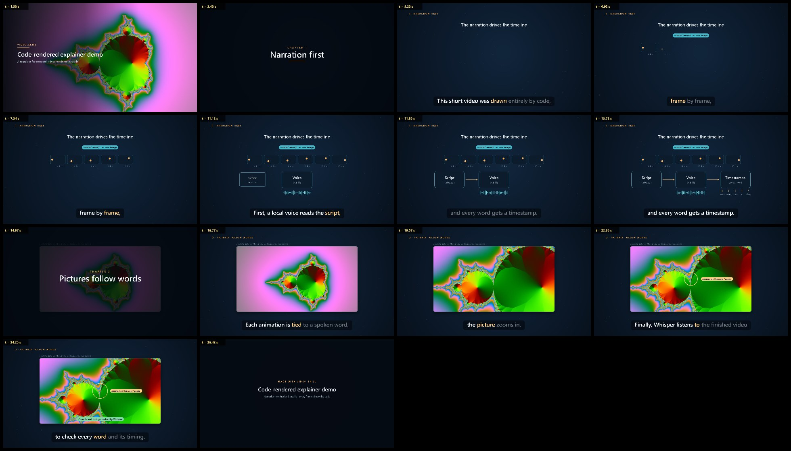

# video_skill

Narrated explainer videos rendered entirely by code on a Windows PC, packaged as an agent skill ([SKILL.md](SKILL.md)) for Claude Code.

You write a script. The pipeline produces an MP4 with:
- English narration
- word-by-word captions
- chapter cards
- animated diagrams and photos
- a synthesized soundtrack

It also writes an SRT file and a transcript.



- **Local.** The voice (Windows OneCore), rendering (headless Chrome), encoding (ffmpeg) and checking (faster-whisper) all run on your machine. Nothing is uploaded.
- **Deterministic.** Every frame is a pure function of time, and every animation is anchored to the spoken word that introduces it.
- **Checked.**
  - Whisper checks the pronunciation of every line.
  - It then checks caption sync on the final MP4.
  - Loudness is normalised to −16 LUFS.

## Requirements

- Windows 10 or 11, with an English voice (Settings → Time & language → Speech)
- Node.js 22+ and ffmpeg on PATH
- Chrome or Edge
- Python 3 with `faster-whisper` and `pillow`, plus the faster-whisper `medium` model (downloaded once, about 1.5 GB)

`node scripts/doctor.mjs` checks all of them.

## Quick start

```powershell
Copy-Item -Recurse template ..\my_video
node scripts\build_timeline.mjs ..\my_video           # voice + timeline
python scripts\whisper_check.py ..\my_video --lines    # pronunciation check
node scripts\render.mjs ..\my_video --stills=auto      # preview sheet: out\stills_sheet.jpg
node scripts\score.mjs ..\my_video                     # soundtrack
node scripts\render.mjs ..\my_video                    # frames
node scripts\render.mjs ..\my_video --encode           # out\demo.mp4
python scripts\verify_sync.py ..\my_video              # words, sync, loudness
```

The template builds the 28-second demo shown above. It renders 840 frames in about 20 seconds.

## Using it with Claude Code

Ask Claude to follow `SKILL.md` in this folder, for example: *"Use video_skill/SKILL.md to make a 2-minute video from this report."*

The skill covers:
- scoping
- a text-only storyboard for your approval
- a voice pass
- scene writing with preview stills for your approval
- rendering and acceptance checks

To install it as a personal skill instead, copy the folder to `~/.claude/skills/`.

## Layout

```
SKILL.md          workflow, rules and commands (for the agent)
scripts/          the engine: TTS, timeline, soundtrack, renderer, checks, image tools
template/         a starter project (video.json, scene.html, js/, assets/)
references/       video.json schema, scene API and recipes, QA checklist, pitfalls, background
docs/             README image
```

## Limits

- English narration only.
- Narration works on Windows only.
- Output is 1920×1080.
- It does not edit camera footage or generate photorealistic motion.

See [SKILL.md](SKILL.md#limits-and-extension-points).

## License

MIT

---

## 繁體中文說明

這是一套在 Windows 電腦上、完全用程式製作「旁白解說影片」的流程，整理成 Claude Code 可以照著執行的 skill（[SKILL.md](SKILL.md)）。

- **旁白：**用 Windows 內建的英文語音，每個字都有時間點，字幕會逐字亮起。
- **畫面：**每一格都由 JavaScript 依時間畫出，每個動畫都綁在旁白裡的某個字上。
- **檢查：**
  - Whisper 逐句檢查發音。
  - 成片再檢查字幕同步和響度。
- **本機執行：**語音、渲染、編碼、檢查全部在本機完成，不會上傳任何內容。

### 使用方式

1. 把 `template/` 複製成新的專案資料夾。
2. 依照上面的 Quick start 依序執行。
3. 用 Claude Code 時，直接請它依照 `SKILL.md` 製作。它會先給你看分鏡稿和預覽圖，你同意後才會渲染成片。

### 限制

- 目前只支援英文旁白。
- 旁白只能在 Windows 上產生。
- 輸出固定為 1920×1080。
- 不處理真人影片剪輯，也不生成寫實的動態畫面。
